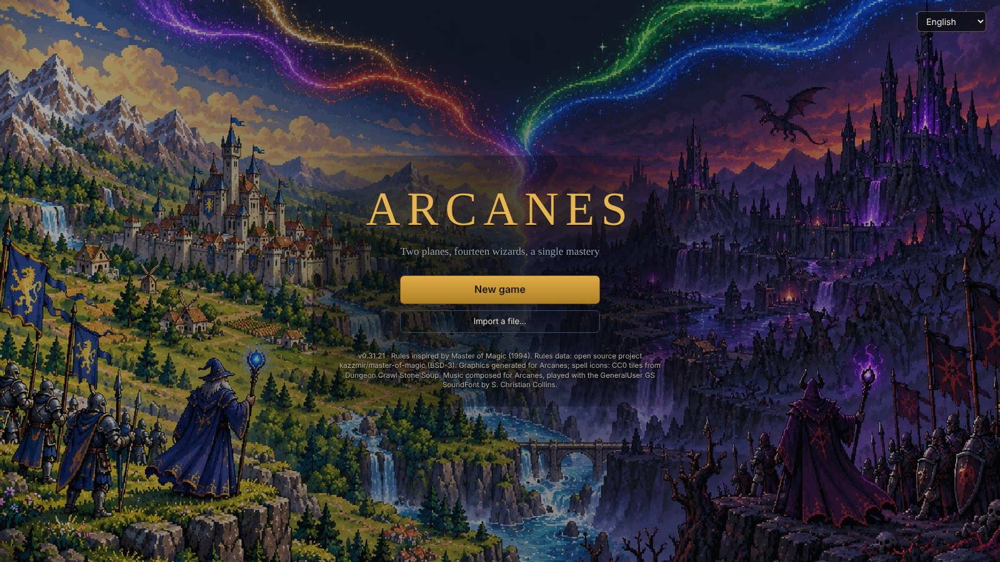
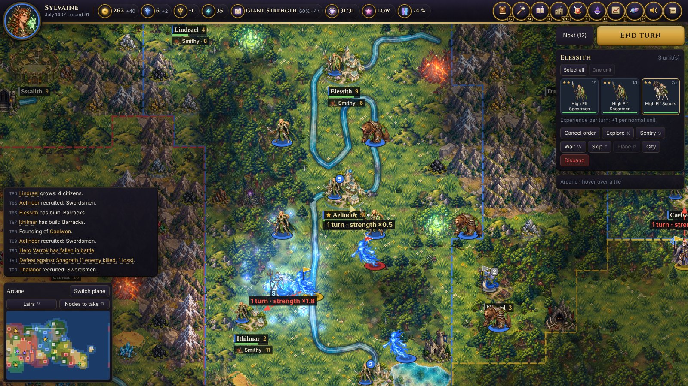
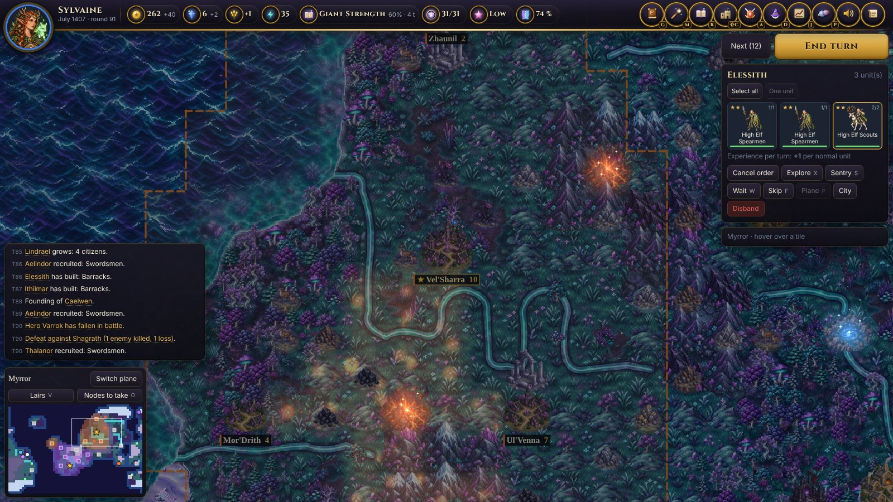
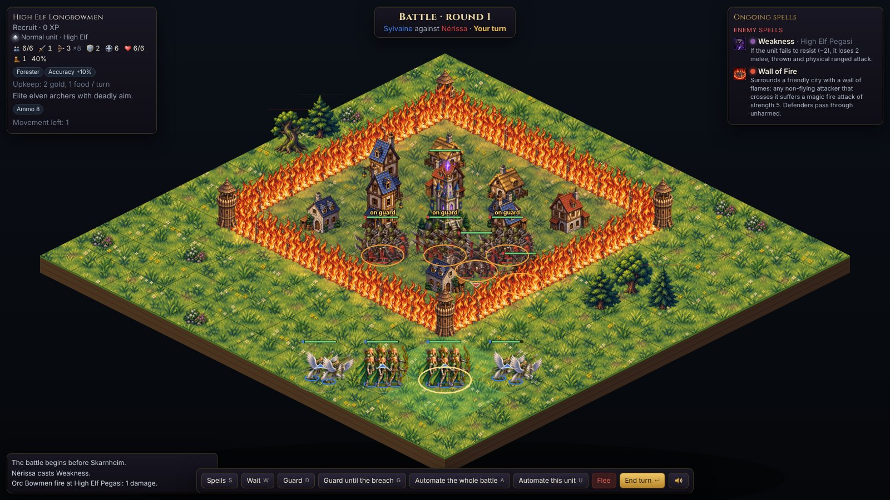
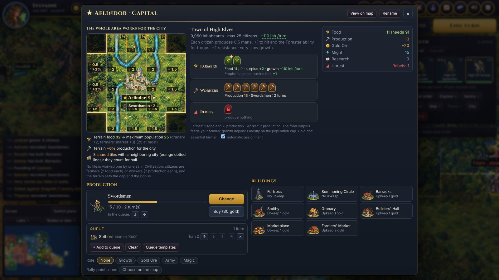
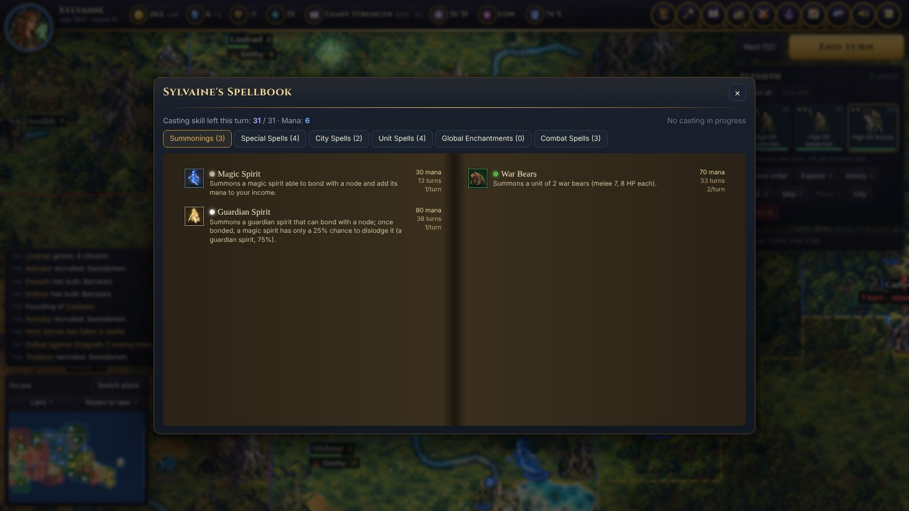
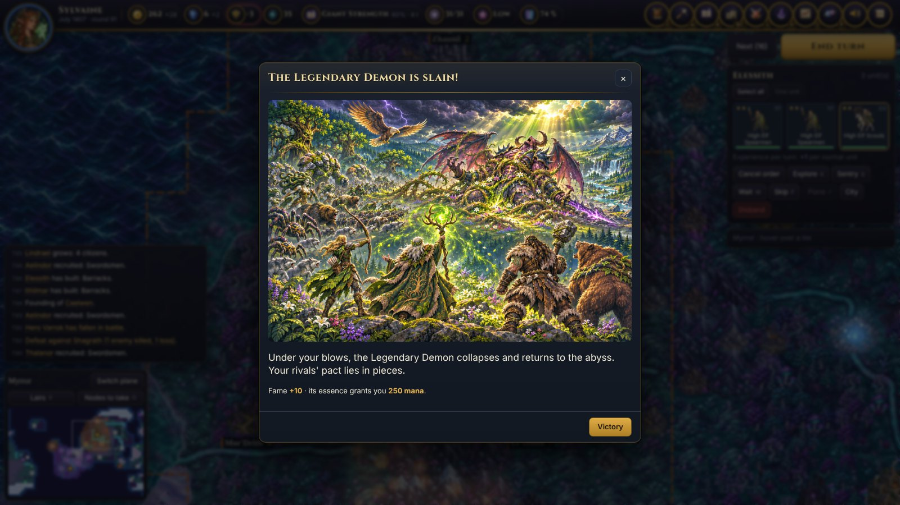

<h1 align="center">Arcanes</h1>

<b>Deux plans, quatorze sorciers, une seule maîtrise.</b> 
<i>Master of Magic</i> (1994) revisité, jouable dans le navigateur.

<a href="https://intelligentrebel.github.io/arcanes/"><b>▶ Jouer dans le navigateur</b></a> · <a href="README.md">English</a>

---

Vous êtes un sorcier. Fondez des cités, levez des armées, étudiez des centaines de sorts dans cinq royaumes de magie, recrutez des héros et menez des batailles tactiques jusque sur les remparts des villes assiégées, sur deux mondes superposés : **Arcanus**, sous le soleil, et le **Miroir**, le monde d'en dessous, où d'autres sorciers ont pris des forces pendant que vous regardiez ailleurs. Le premier à lancer le **Sort de Maîtrise**, ou le dernier debout, l'emporte.

Arcanes garde ce qui rendait *Master of Magic* inoubliable et laisse tomber les agacements de l'époque DOS : chaque règle est montrée, chaque chiffre expliqué, l'IA joue sans tricher, et une partie tient dans une seule page HTML, sans rien installer.

 

## Au programme

- **14 peuples, chacun avec ses cités et ses murailles**, des flèches des hauts-elfes aux ruches klackons et aux salles de pierre des nains, et un ouvrage unique par peuple, débloqué par la recherche en milieu de partie.
- **Cinq royaumes de magie et l'Arcane** : Vie, Mort, Chaos, Nature et Sorcellerie, plus de 200 sorts, des créatures à invoquer, des enchantements globaux qui changent le monde, et le Sort de Maîtrise.
- **Deux plans à la géographie propre** : les terres d'Arcanus, et le Miroir, ses landes d'argent, ses forêts violettes et ses pics d'obsidienne. Des tours de sorcellerie les relient.
- **Héros et légendes** : des héros qui montent en niveau et portent des artefacts, des quêtes épiques dans des repaires mortels révélés indice après indice, un Livre de légende dont les fragments sont dispersés dans le monde.
- **Batailles tactiques** : attaques de flanc, tirs depuis les remparts, murailles assez épaisses pour s'y tenir, portes à enfoncer, tours qui ripostent, Mur de feu et sorts de combat, avec une résolution automatique qu'on peut rejouer à la main.
- **Une IA qui ne triche pas** : les niveaux changent la façon dont les rivaux jouent, jamais ce qu'ils reçoivent. En Difficile, ils s'allient contre celui qui s'envole ; en Hardcore, une coalition peut invoquer le **Démon légendaire** contre le meneur.
- **Les crises de fin** : passé le tour 200, le sorcier qui écrase la partie s'attire l'une de cinq crises, d'un Seigneur liche qui se relève sans cesse à un hiver qui gèle les récoltes.
- **Un monde vivant** : frontières, diplomatie et traités, événements et dilemmes, grands moments illustrés, chronique de la partie.
- **11 langues** : le jeu suit la langue du navigateur (l'anglais sinon), et se change depuis l'écran titre ou le menu.
- **Une bande originale**, avec un thème pour chaque peuple.

 

 

## Jouer

- **En ligne** : [intelligentrebel.github.io/arcanes](https://intelligentrebel.github.io/arcanes/), rien à installer. Les parties sont gardées dans le navigateur, et s'exportent dans un fichier.
- **Hors ligne** : téléchargez la dernière version sur la page [Releases](https://github.com/IntelligentRebel/arcanes/releases) (ou assemblez-la, ci-dessous), décompressez-la et ouvrez `arcanes/index.html`. La copie hors ligne demande à GitHub, au lancement, s'il existe une version plus récente (ça se coupe dans le menu).

Le menu contient une page *Aide et raccourcis* qui liste toutes les touches.

## Assembler le jeu

Il faut Python 3 et Node.js : `python3 tools/build.py` produit `dist/arcanes/index.html`. Le code est écrit en français ; les traductions sont dans `i18n/<langue>.json` (voir [i18n/README.md](i18n/README.md)).

## Crédits

- Conception et direction : **Olivier Roland**. Code écrit avec **Claude** (Anthropic).
- Règles inspirées de *Master of Magic* (Simtex, 1994). Arcanes est un projet de fan, sans lien avec les détenteurs de *Master of Magic*. Données de règles en partie tirées de [kazzmir/master-of-magic](https://github.com/kazzmir/master-of-magic) (BSD-3-Clause).
- Graphismes générés pour Arcanes avec la génération d'images d'OpenAI.
- Musique composée pour Arcanes, jouée avec la SoundFont GeneralUser GS de S. Christian Collins.
- Police de titres : Cinzel (SIL Open Font License). Analyseur : acorn (MIT).

© 2026 Olivier Roland. Tous droits réservés : le code est public pour qu'on puisse le lire et jouer, mais aucune licence n'autorise sa réutilisation. Les composants tiers gardent leur licence, voir [THIRD_PARTY.md](THIRD_PARTY.md).
