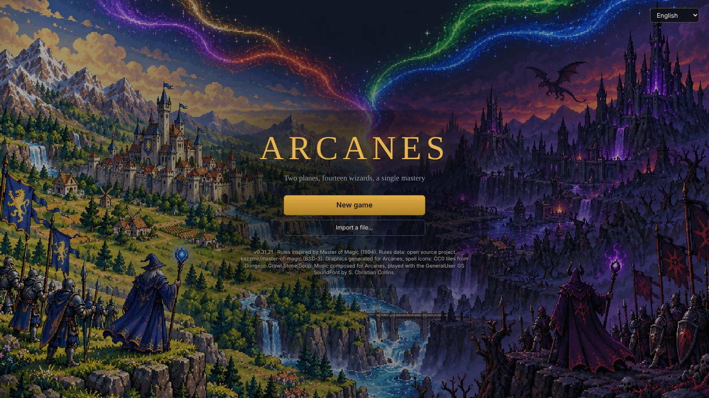
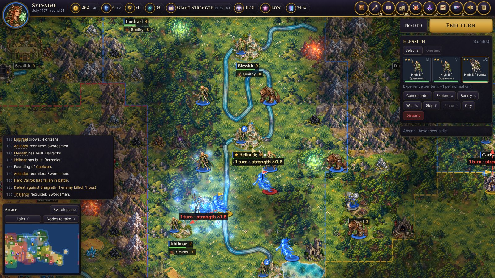
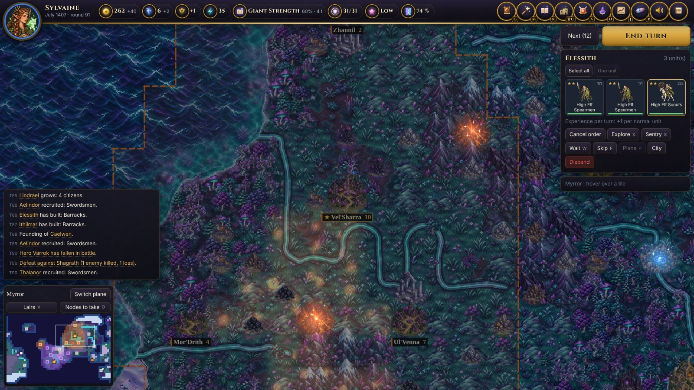
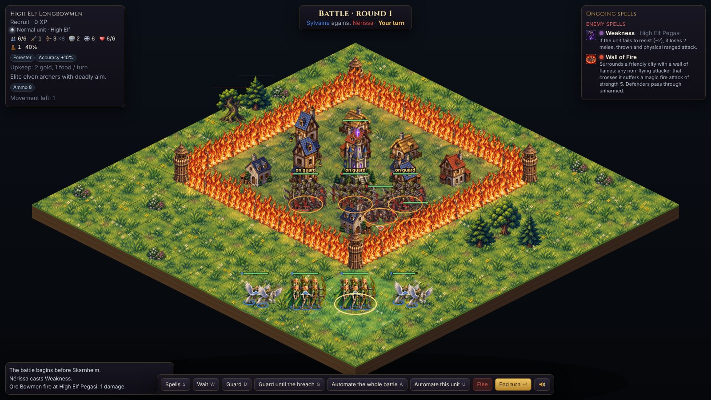
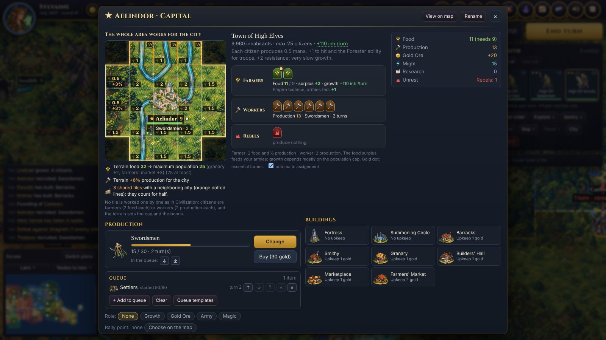
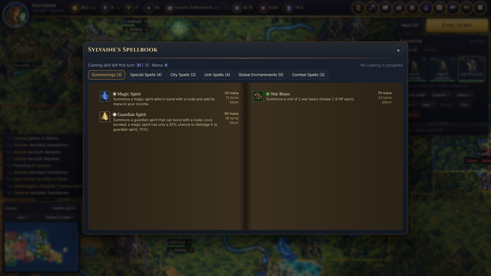
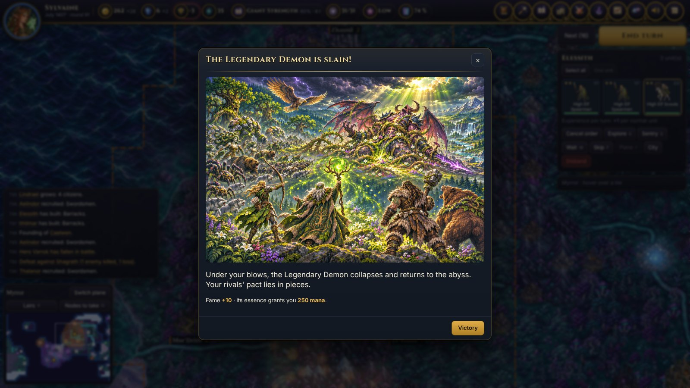

<p align="center"></p>

<h1 align="center">Arcanes</h1>
<p align="center"><b>Two planes, fourteen wizards, a single mastery.</b><br>
A modern take on <i>Master of Magic</i> (1994), playable in your browser.</p>

<p align="center"><a href="https://intelligentrebel.github.io/arcanes/"><b>▶ Play now in your browser</b></a> · <a href="README.fr.md">Version française</a></p>

---

You are a wizard. Found cities, raise armies, research hundreds of spells across five realms of magic, recruit heroes, and fight tactical battles on the walls of besieged cities, on two worlds stacked on top of each other: sunny **Arcanus**, and **Myrror**, the strange world below, where the other wizards have been growing strong while you were not looking. The first to cast the **Spell of Mastery**, or the last one standing, wins.

Arcanes keeps what made *Master of Magic* unforgettable and drops the irritants of the DOS era: every rule is shown, every number explained, the AI plays without cheating, and a game runs from a single HTML page, with nothing to install.

<p align="center"> </p>

## What is in it

- **14 races, each with its own cities and walls**, from High Elf spires to Klackon hives and Dwarven mountain halls, plus a unique wonder per race, unlocked by research mid-game.
- **Five realms of magic and the Arcane**: Life, Death, Chaos, Nature and Sorcery, more than 200 spells, summoned creatures, global enchantments that reshape the world, and the Spell of Mastery.
- **Two planes with their own geography**: the lands of Arcanus, and Myrror, with its silver moors, violet forests and obsidian peaks. Towers of wizardry link them.
- **Heroes and legends**: heroes that level up and carry artifacts, epic quests in deadly lairs revealed clue by clue, a legendary Book whose fragments are scattered across the world.
- **Tactical battles**: flanking, ranged fire from the ramparts, walls thick enough to stand on, gates to batter, towers that shoot back, Wall of Fire, and combat spells, with an optional auto-resolve you can replay by hand.
- **An AI that does not cheat**: difficulty levels change how well rivals play, never what they get. On Hard, they ally against whoever runs away with the game; on Hardcore, a coalition can summon the **Legendary Demon** against the leader.
- **Living world**: territory borders, diplomacy and treaties, random events and dilemmas, illustrated moments for great deeds, a chronicle of the game.
- **11 languages**: English, 简体中文, Deutsch, Español, Português, Русский, Français, 日本語, 한국어, Italiano, Polski. The game follows your browser's language (English otherwise); you can change it from the title screen or the menu.
- **Original soundtrack**, a theme for each people.

<p align="center"> </p>
<p align="center"> </p>

## Play

- **Online**: [intelligentrebel.github.io/arcanes](https://intelligentrebel.github.io/arcanes/), nothing to install. Your games are saved in your browser, and you can export them to a file.
- **Offline**: download the latest build from the [Releases](https://github.com/IntelligentRebel/arcanes/releases) page (or build it, below), unzip it, and open `arcanes/index.html`.

Controls follow the classic 4X conventions: click a stack to select it, click a destination to move, right-click to deselect, **Enter** to end the turn. The menu has a *Help and shortcuts* page listing every key.

## Build from source

You need Python 3 and Node.js.

```
python3 tools/build.py        # -> dist/arcanes/index.html
```

The source code is written in French (variables, comments, texts); `tools/i18n_build.js` wraps every displayed text at build time, and the translations live in `i18n/<language>.json` (see [i18n/README.md](i18n/README.md)). The engine tests run under Node (`node tests/<name>_test.js`), and `tools/banc/` holds the overnight AI test bench used to tune the AI: an AI change is kept only when hundreds of games show it helps.

## Credits

- Game design and direction: **Olivier Roland**. Code written with **Claude** (Anthropic).
- Rules inspired by *Master of Magic* (Simtex, 1994). Arcanes is a fan project, not affiliated with or endorsed by the owners of *Master of Magic*. Rules data partly derived from [kazzmir/master-of-magic](https://github.com/kazzmir/master-of-magic) (BSD-3-Clause).
- Graphics generated for Arcanes with OpenAI image generation; spell icons and some sprites from the CC0 tiles of [Dungeon Crawl Stone Soup](https://github.com/crawl/tiles).
- Music composed for Arcanes, played with the GeneralUser GS SoundFont by S. Christian Collins.
- Title font: Cinzel (SIL Open Font License). Parser: acorn (MIT).

© 2026 Olivier Roland. All rights reserved: the source is public so you can read it and play, but no license is granted to reuse it. Third-party components keep their own licenses, see [THIRD_PARTY.md](THIRD_PARTY.md).
